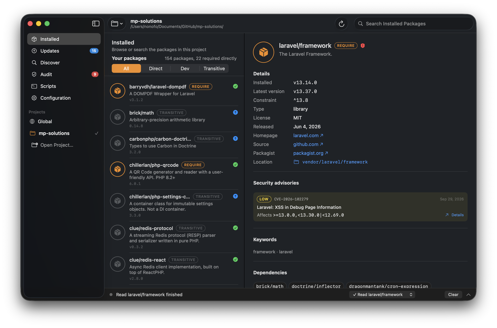
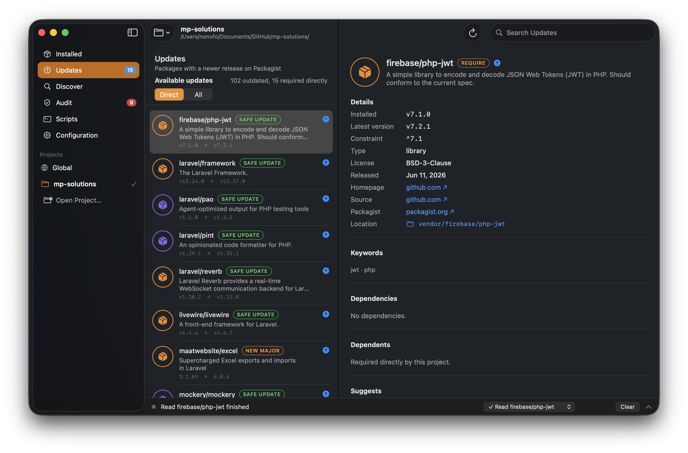
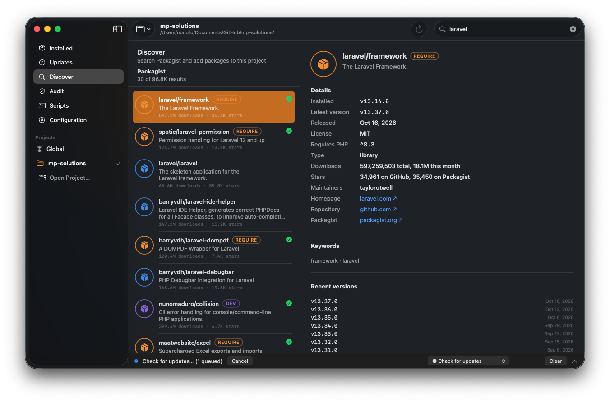
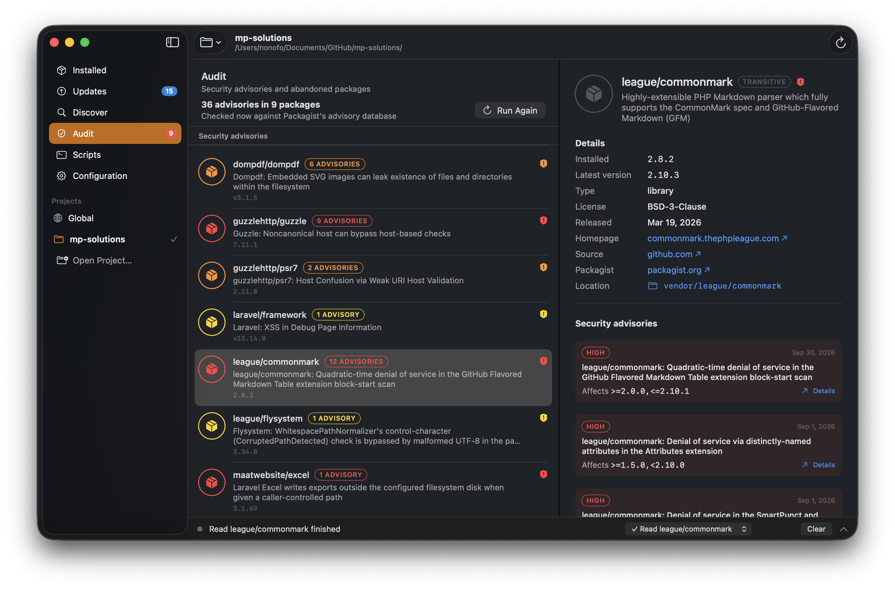
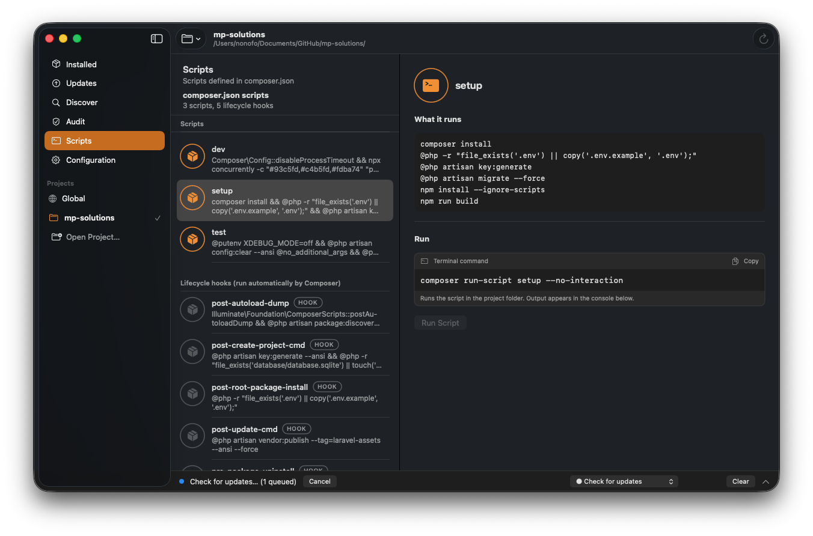
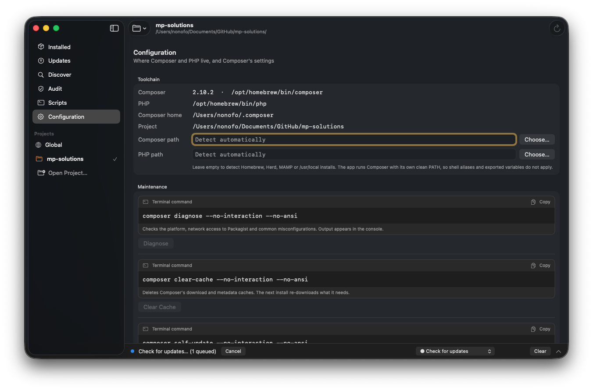
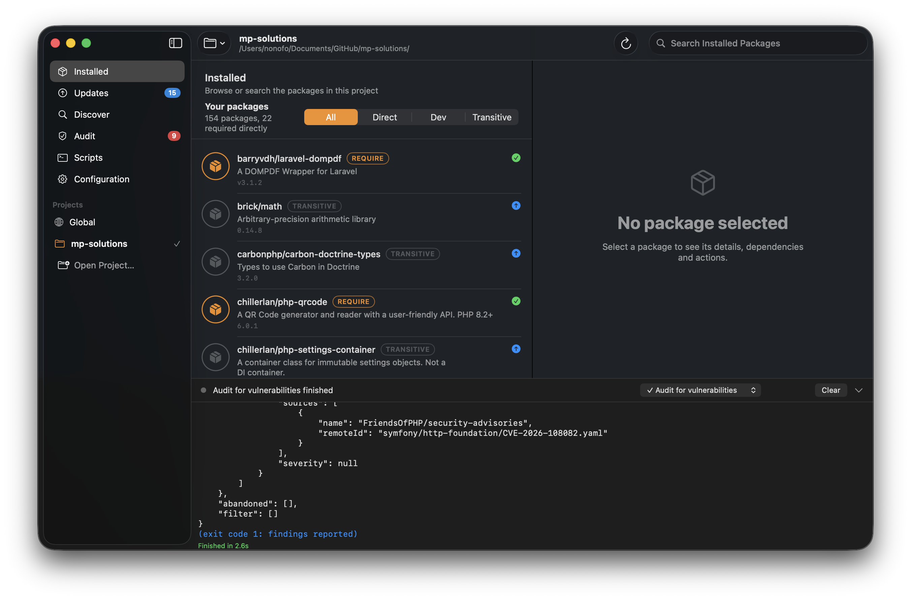
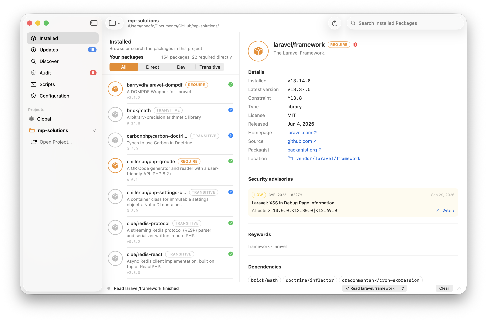

<h1 align="center">📦 ComposerUI</h1>

<p align="center">
  <b>A native macOS app for <a href="https://getcomposer.org">Composer</a>, the PHP package manager.</b><br>
  Browse, search, install, update and audit the packages of any PHP project without hiding what Composer is doing.
</p>

<p align="center">
  
  
  
  
</p>

<p align="center">
  
</p>

ComposerUI is to Composer what [BrewUI](https://github.com/Homebrew/BrewUI) is to Homebrew: a
graphical front end for people who would rather click than type, that still shows the exact
Terminal command before anything runs and streams Composer's real output in a console. Composer
stays the source of truth. The app never edits `composer.json`, `composer.lock` or `vendor/`
itself; every change goes through the `composer` executable.

## What it does

<table>
  <tr>
    <td width="33%" valign="top">
      <h3>📦 Installed</h3>
      Every package in <code>vendor/</code>, tagged <b>require</b>, <b>dev</b> or <b>transitive</b>. Select one for its version, license, constraint, dependencies, dependents, security advisories, and the update or remove command.
    </td>
    <td width="33%" valign="top">
      <h3>⬆️ Updates</h3>
      What <code>composer outdated</code> found, marked <b>safe update</b> (inside the constraint) or <b>new major</b> (needs a constraint change). Update one package, bump its constraint, or update everything.
    </td>
    <td width="33%" valign="top">
      <h3>🔍 Discover</h3>
      Search Packagist as you type. See downloads, stars, maintainers, recent versions and the PHP requirement, then require a package as a normal or dev dependency with the constraint you choose.
    </td>
  </tr>
  <tr>
    <td valign="top">
      <h3>🛡️ Audit</h3>
      <code>composer audit</code> against Packagist's advisory database: every advisory with its severity, CVE, affected versions and link, plus abandoned packages and their suggested replacements.
    </td>
    <td valign="top">
      <h3>⌨️ Scripts</h3>
      The scripts in <code>composer.json</code>, separated from Composer's own lifecycle hooks, with what each one runs and a button to run it.
    </td>
    <td valign="top">
      <h3>🖥️ Console</h3>
      Every command the app runs, with its full stdout and stderr, exit status and duration. Commands run one at a time; cancel a running one at any point.
    </td>
  </tr>
</table>

<p align="center">
  <br>
  <sub>Updates: what is outdated, whether it fits the current constraint, and the exact command.</sub>
</p>

<p align="center">
  <br>
  <sub>Discover: Packagist search with the require command built from your choices.</sub>
</p>

<p align="center">
  <br>
  <sub>Audit: advisories grouped by package, worst severity first.</sub>
</p>

<details>
<summary>More screenshots: Scripts, Configuration, the console and light mode</summary>
<p align="center">
  <br>
  <br>
  <br>
  
</p>
</details>

### Projects

Composer works per project, so the sidebar lists your recent projects plus **Global**
(`composer global`). Open any folder that contains a `composer.json` with ⌘O. A project without a
`vendor/` folder gets an **Install Dependencies** button instead of an empty list.

### Transparency rules

- Every action shows its Terminal command, with a Copy button, before you run it. Flags that exist
  only so the app can parse output (`--format=json`) are hidden from that text.
- Composer runs with its own clean `PATH` (the PHP directory, the Composer directory, then the
  system paths) and `COMPOSER_NO_INTERACTION=1`. Your shell aliases and exported variables do not
  apply, so the app behaves the same whether launched from Finder or a terminal.
- Arguments are passed as argv, never through a shell, so package names and paths cannot be
  misread.
- Reads (`show`, `outdated`, `audit`, `config`) and writes (`require`, `remove`, `update`,
  `run-script`) go through one serial queue, so two commands never race on `vendor/`.

## Requirements

- macOS 15 or newer, Apple Silicon or Intel.
- Composer 2 and a PHP interpreter. The app looks in Homebrew (`/opt/homebrew`, `/usr/local`),
  Laravel Herd and MAMP. Any other location can be set under **Configuration**.

## Build from source

Xcode 16 or newer, and [XcodeGen](https://github.com/yonaskolb/XcodeGen) to generate the project.

```sh
git clone https://github.com/dexter288/ComposerUI
cd ComposerUI
brew install xcodegen
xcodegen generate
open ComposerUI.xcodeproj      # then Run
```

Or from the command line:

```sh
xcodebuild -project ComposerUI.xcodeproj -scheme ComposerUI -configuration Release build
```

The non-UI code is a Swift package, so its tests run without Xcode's GUI:

```sh
swift test
```

### Launch arguments

For screenshots and manual checks the app accepts arguments that only set its initial state:

```sh
ComposerUI.app/Contents/MacOS/ComposerUI \
  --project ~/Sites/my-app --tab updates --package laravel/framework \
  --query monolog --script test --console --appearance light
```

`--tab` is one of `installed`, `updates`, `discover`, `audit`, `scripts`, `configuration`.

## How it is built

```text
View → ViewModel / AppModel → Repositories and decoders → composer CLI or Packagist JSON API
```

| Module | Responsibility |
| --- | --- |
| `Sources/ComposerCore` | Domain models (packages, advisories, projects), the command catalogue and the command-centre contract. No Foundation networking, no UI. |
| `Sources/ComposerCLI` | Finding `composer` and `php`, running them as subprocesses with streamed output and cancellation, and decoding Composer's JSON (`show`, `outdated`, `audit`, `show <package>`, `installed.json`, `composer.json`, `config --list`). |
| `Sources/ComposerPackagist` | The Packagist search and package endpoints. |
| `Sources/ComposerUI` | SwiftUI views, view models, the console, project store and settings. |
| `App/` | The app shell: entry point, window, assets and `Info.plist`. |
| `Tests/` | Decoder tests against real Composer output captured as fixtures. |

Composer has no JSON form of `composer depends`, so dependencies and dependents come from
`vendor/composer/installed.json`, which lists every installed package's `require`, `replace` and
`provide`. Everything else is read from Composer's own `--format=json` output. See
[ARCHITECTURE.md](ARCHITECTURE.md) for the details.

## Status

Alpha. It is used daily on Laravel projects but has rough edges. Known gaps:

- No handling of Composer's interactive prompts; commands run with `--no-interaction`, so a prompt
  becomes a failure shown in the console.
- Private repositories work only when Composer can already authenticate on its own
  (`auth.json`, `COMPOSER_AUTH` or an SSH agent).
- No menu-bar mode and no notifications yet.
- Dependents are read from `installed.json`, which is not refreshed until the next Composer run.

Issues and pull requests are welcome. Please include your macOS and Composer versions and, for a
failed command, the console transcript.

## Credits

The layout, the console and the "show the command first" rule are modelled on
[BrewUI](https://github.com/Homebrew/BrewUI), Homebrew's official macOS GUI. ComposerUI shares no
code with it and is not affiliated with Homebrew, Composer or Packagist.

## License

[MIT](LICENSE).
